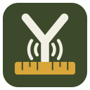

    

<h1 align="center">YARD</h1>

    
    
    
    

    <strong>Requires the latest version of <a href="https://github.com/CBATeam/CBA_A3/releases">CBA A3</a>.</strong>

**YARD** (Yard's a radio doohickey) is a radio and voice communications mod for Arma 3: direct speech and simulated radios, with signal loss over the terrain, vehicle intercoms, languages and more. It carries voice itself: the Arma server hosts the voice server, so there's no TeamSpeak or other voice program to install.

YARD is a modified version of [ACRE2](https://github.com/IDI-Systems/acre2) by the ACRE2 Team (IDI-Systems), and keeps its API, so missions and mods made for ACRE2 work with it. It is not affiliated with or endorsed by the ACRE2 Team.

**[Documentation](https://brettmayson.github.io/yard/)** · [Installation](https://brettmayson.github.io/yard/user/installation.html) · [Voice server setup](https://brettmayson.github.io/yard/user/voice-server.html) · [YARD and ACRE2](https://brettmayson.github.io/yard/yard-vs-acre.html)

## YARD and ACRE2

The radios, signal simulation, intercoms, babel and the rest of the gameplay come from ACRE2. YARD changes how voice gets from one player to another, and the extension underneath.

| | ACRE2 | YARD |
| --- | --- | --- |
| Voice | TeamSpeak 3 with the ACRE2 plugin | Built in: the Arma server hosts the voice server |
| Players need | TeamSpeak 3, the plugin, and the right TeamSpeak server and channel | Nothing beyond the mod |
| Server needs | A TeamSpeak server | One open UDP port and its public address in the CBA settings |
| Direct speech | TeamSpeak's activation | Voice activation (with noise suppression and speech detection) or push-to-talk |
| Extensions | `acre_x64.dll` (C++) and the TeamSpeak plugin | One extension, `yard_x64.dll` / `yard_x64.so` (Rust) |
| API, classnames, configs | `acre_api_fnc_*`, `ACRE_*`, `CfgAcreComponents` | The same |
| Mod folder | `@acre2` | `@yard` |

**Compatible with ACRE2.** The `acre_api_fnc_*` functions (none removed), the `ACRE_*` classnames, `CfgAcreComponents` and the vehicle configs, the `acre_*` addon names, CBA events, setting names and keybind IDs are all unchanged. YARD replaces ACRE2, so don't load both.

**Voice.** Players connect to the Arma server's voice server automatically, with a one-time ticket, encrypted. The server only sends voice to players who can hear it: direct speech to those close enough, radio traffic to those tuned in. Radio and babel effects are ACRE2's, ported and tested against the originals; positional sound reimplements X3DAudio's behaviour. New for players: microphone and speaker selection, voice activation with noise suppression or push-to-talk, a microphone test, a mute key, a push-to-talk release delay, hearing yourself on your other radios, and a *YARD Voice* status page on the map.

**Removed with TeamSpeak.** TeamSpeak channel switching (`ts3ChannelSwitch`, `ts3ChannelName`, `ts3ChannelPassword`) and `unmuteClients`. `acre_api_fnc_isVOIPConnected` reports the voice server connection.

**Signal fixes.** The propagation models are ported from ACRE2's C++ and give the same results, except where ACRE2 had bugs:

- **Longley-Rice (ITM)** used placeholder `cos`/`sin` functions that returned -1, and was given antenna heights above sea level instead of above the ground (so radios on hills became masts). Both are fixed, so ITM is much weaker than in ACRE2: typically around 20 dB. Reported upstream: [IDI-Systems/acre2#1435](https://github.com/IDI-Systems/acre2/pull/1435), [#1436](https://github.com/IDI-Systems/acre2/pull/1436).
- **LOS Multipath** no longer depends on what was computed before (its terrain peak cache only ever grew).
- The **signal map** debug tool works without ACRE2's developer tools.

**For server administrators.** Set the voice server's public address (`Addon Options → YARD Voice Server`, or `YARD_VOICE_ADDRESS`) and open UDP port 9987 (`YARD_VOICE_PORT`). Linux dedicated servers are supported with `yard_x64.so`, included in releases.

## Features

- Accurate simulations of the AN/PRC-343, AN/PRC-77, AN/PRC-148, AN/PRC-117F, AN/PRC-152, SEM 52 SL, SEM 70 and BF-888S.
- Vehicle racks: AN/VRC-64, AN/VRC-103, AN/VRC-110, AN/VRC-111, SEM 90.
- Deployable antennas and a ground spike antenna.
- Radio signal simulation over the terrain: Arcade, LOS Simple, LOS Multipath (default) and the experimental Longley-Rice (ITM) model.
- Real-time voice occlusion by buildings and other objects, and configurable vehicle sound attenuation.
- Babel: give sides or players their own languages.
- Multi-channel audio: people on the radio are heard locally as well.
- Radios with external speakers, and sharing radios with other players.
- Vehicle intercoms and infantry phones.
- Zeus and spectator integration.
- Radio presets for mission makers, and a documented framework for radios, antennas, intercoms, racks and game modes.
- Creator DLC compatibility (Global Mobilization, S.O.G. Prairie Fire, Western Sahara, CSLA Iron Curtain, Spearhead 1944).

## Building

Addons are built with [HEMTT](https://github.com/BrettMayson/HEMTT), the extension with Rust (`rust/`). See [Building](https://brettmayson.github.io/yard/development/building.html) and [Building the Extension](https://brettmayson.github.io/yard/development/building-extensions.html).

## Licence and credits

YARD is licensed under the GNU General Public License v3 ([LICENSE](LICENSE)), as ACRE2 is. Some folders contain their own LICENSE file for items licensed differently.

Most of YARD is the work of the ACRE2 Team and ACRE2's contributors. See [Credits](https://brettmayson.github.io/yard/credits.html).
