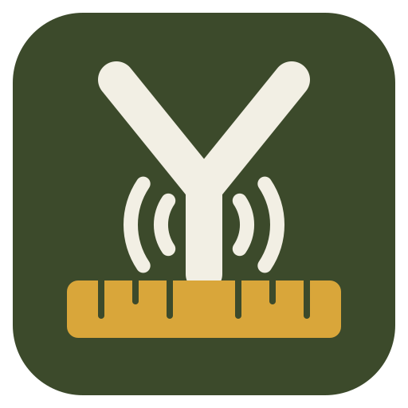

# YARD

**YARD** is a radio and voice communications mod for Arma 3. Players talk directly and over simulated radios, with signal loss over the terrain, vehicle intercoms, languages and more. It carries voice itself: the Arma server hosts the voice server, so no TeamSpeak or other voice program is needed.

YARD is a modified version of [ACRE2](https://github.com/IDI-Systems/acre2) and keeps its API, so missions and mods made for ACRE2 work with it. See [YARD and ACRE2](yard-vs-acre.md) for what's different.

Requires [CBA A3](https://github.com/CBATeam/CBA_A3/releases).

## Where to start

- **Playing:** [Installation](user/installation.md), then [Basic Concepts](user/basic-concepts.md).
- **Running a server:** [Voice Server](user/voice-server.md). Two settings and one UDP port.
- **Making missions:** [Mission Making Intro](frameworks/mission-making-intro.md) and the [Functions List](frameworks/functions-list.md).
- **Coming from ACRE2:** [YARD and ACRE2](yard-vs-acre.md).

## Features

- Accurate simulations of the AN/PRC-343, AN/PRC-77, AN/PRC-148, AN/PRC-117F, AN/PRC-152, SEM 52 SL, SEM 70 and BF-888S.
- Vehicle racks (AN/VRC-64, AN/VRC-103, AN/VRC-110, AN/VRC-111, SEM 90), vehicle intercoms and infantry phones.
- Radio signal simulation over the terrain, with antenna patterns and several propagation models.
- Voice occlusion by buildings and objects, and vehicle sound attenuation.
- Babel: give sides or players their own languages.
- Radios with external speakers, and sharing radios with other players.
- Zeus and spectator integration.
- Built-in voice: voice activation with noise suppression, or push-to-talk.
- A documented framework for radios, antennas, intercoms, racks and game modes.

YARD is open source under the GNU General Public License v3. The source is on [GitHub](https://github.com/BrettMayson/yard).
